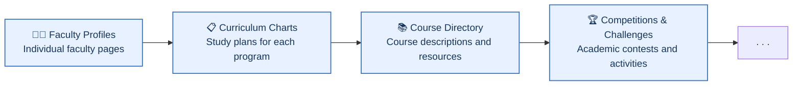

  <!-- Place the official logo at profile/assets/shahed-ce-logo.png -->
  

  ## 💻 Computer Engineering Scientific Association at Shahed University

  **Turning 🧠 knowledge into 💡 action — building ⚡ motivation and 🌱 hope.**

  **Council Term: 1405–1406 | 2026–2027**

  🇮🇷 [فارسی](README.fa.md) · 🇬🇧 **English** · 🇸🇦 [العربية](README.ar.md)

  
  
  
  
  
  
  

  **📰 Matris Magazine**

  
  
  

---

## 👋 Welcome to Shahed CE

We are the **Computer Engineering Scientific Association at Shahed University** — a student-led community connecting academic learning with practical experience, research, collaboration, and new opportunities.

We believe an academic association should be more than an event organizer. It can be a place where students learn together, build projects, exchange experiences, connect with faculty and professionals, and create work that remains useful for future generations.

🌐 **Online Community:** All our activities, events, and collaborations are coordinated through online platforms, allowing students, alumni, faculty members, and partners to participate regardless of their location.

## 🎯 Our Mission

- 🧠 Connect theoretical knowledge with practical skills and experience.
- 📚 Encourage continuous learning, research, and knowledge sharing.
- 🛠️ Support student projects, open-source work, and teamwork.
- 🤝 Build connections among students, faculty members, alumni, and the technology community.
- 🚀 Help students explore academic, research, and career pathways.
- 🗂️ Document activities and share useful outcomes with future generations.

## 🧩 What We Work On

| Area | What it includes |
|:---|:---|
| 🎓 Learning & Skills | Courses, workshops, study groups, and practical learning activities |
| 🔬 Research | Research introductions, student projects, academic discussions, and research opportunities |
| 💻 Projects & Open Source | Collaborative projects, code, tools, and technical documentation |
| 🌐 Community & Industry | Sessions with professionals, alumni, organizations, and technology communities |
| 📰 Science Communication | Interviews, articles, technical explainers, and the *Matris* student magazine |

## 🎓 Academic Programs & Study Plans

This section introduces the academic programs and specializations offered by the Computer Engineering group at Shahed University. Curriculum charts and study plans will be added for each program.

| Degree | Program / Specialization | Curriculum |
|:---|:---|:---:|
| 🎓 Bachelor's | Computer Engineering — Software Engineering (B.Sc.) | Coming soon |
| 🎓 Master's | Computer Engineering and Science — Computer Systems Architecture (M.Sc.) | Coming soon |
| 🎓 Master's | Computer Engineering and Science — Cyber Security (M.Sc.) | Coming soon |
| 🎓 Ph.D | Computer Engineering — Network Engineering | Coming soon |

> 📚 **Study Plans:** Curriculum charts and semester-by-semester course plans will be added progressively.

## 📰 Matris — Student Magazine

**Matris** is the student magazine of the Computer Engineering Scientific Association at Shahed University. It provides a platform for technical and scientific articles, interviews, research highlights, technology trends, and student perspectives.

🌐 **Follow Matris:** [📣 Telegram](https://t.me/MatrisMagazine) · [🟦 Rubika](https://rubika.ir/MatrisMagazine) · [✍️ Virgool](https://virgool.io/MatrisMagazine)

🌱 We welcome student contributions, creative ideas, articles, and collaborations in writing, editing, research, and design.

## 👥 Association Executive Council

The association is managed by an elected council. Its members and assigned responsibilities are renewed through annual student elections.

**Current Term: 1405–1406 (2026–2027)**

| Member | Position | GitHub |
|:---|:---|:---:|
| **Seyed Ali Etrati** | 🧭 Secretary & Association Lead | [@SAEtrati](https://github.com/SAEtrati) |
| **Seyed Mohammad Etrati** | 🌱 Publications & Innovation Lead | [@SMEtrati](https://github.com/SMEtrati) |
| **Mohammad Mehdi Ayyouzi** | ⚡ Deputy Secretary & Executive Affairs Lead | [@MAHDI1824](https://github.com/MAHDI1824) |
| **Mohsen Ansarifar** | 🧠 Academic & Cultural Affairs Lead | [@Mohsen-A-F](https://github.com/Mohsen-A-F) |
| **Mohammad Ali Sharifzadeh Hesari** | 🎓 Research & Student Affairs Lead | — |
| **Mohammad Fateh** | 📣 Media & Communications Lead | [@protonmemmad](https://github.com/protonmemmad) |

> 🤝 We welcome your ideas, participation, and collaboration!

## 🏛️ Faculty & Academic Group

For official information about the Computer Engineering academic group and its faculty members, please visit the [Shahed University group page](https://scimet.shahed.ac.ir/eng-comp).

> [!NOTE]
> This section is currently being updated. Individual faculty profiles will be added progressively.

## 🗺️ Current Roadmap

We are gradually developing this GitHub space to make academic information, educational resources, and student activities more accessible.

> 🌱 These are our current priorities. Further initiatives will take shape as the association grows and new needs and opportunities emerge.

## 🤝 Get Involved

Students, alumni, faculty members, and professionals interested in our activities are welcome to connect and contribute.

1. 🔎 Explore the repositories in this organization.
2. 📖 Read the `README` and license in the repository you want to use.
3. 💡 Share ideas, report issues, or suggest improvements through the repository's Issues section when enabled.
4. 🧑‍💻 Contribute through a Pull Request when contributions are open and the repository provides contribution instructions.
5. 🌟 Remember: documentation, design, testing, research, and sharing experience are valuable contributions too — not only coding.

Each repository may have its own scope, contribution rules, and license. Please check those details before reusing or contributing content.

---

### 💡 Learn together. Build together. Leave something useful behind.

**Shahed CE** · Computer Engineering Scientific Association at Shahed University

