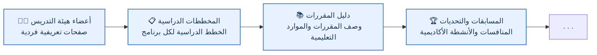

  <!-- ضع الشعار الرسمي في المسار profile/assets/shahed-ce-logo.png -->
  

  ## 💻 الجمعية العلمية لهندسة الحاسوب في جامعة شاهد

  **تحويل 🧠 المعرفة إلى 💡 تطبيق؛ وبناء ⚡ الدافعية و🌱 الأمل.**

  **الدورة الحالية للمجلس: ١٤٠٥–١٤٠٦ | ٢٠٢٦–٢٠٢٧**

  🇮🇷 [فارسی](README.fa.md) · 🇬🇧 [English](README.md) · 🇸🇦 **العربية**

  
  
  
  
  
  
  

  **📰 مجلة ماتريس**

  
  
  

---

## 👋 مرحبًا بكم في Shahed CE

نحن **الجمعية العلمية لهندسة الحاسوب في جامعة شاهد**؛ مجتمع طلابي يربط بين التعلّم الأكاديمي والخبرة العملية والبحث العلمي والتعاون والفرص الجديدة.

نؤمن بأن الجمعية العلمية ينبغي أن تكون أكثر من مجرد جهة تنظّم الفعاليات. يمكن أن تكون مساحة يتعلّم فيها الطلاب معًا، وينفّذون المشاريع، ويتبادلون الخبرات، ويتواصلون مع أعضاء هيئة التدريس والمتخصصين، وينجزون أعمالًا تبقى مفيدة للأجيال القادمة.

🌐 **مجتمع عبر الإنترنت:** تُنسّق جميع أنشطتنا وفعالياتنا وتعاوناتنا عبر المنصات الإلكترونية، مما يتيح للطلاب والخريجين وأعضاء هيئة التدريس والشركاء المشاركة بغض النظر عن أماكن وجودهم.

## 🎯 رسالتنا

- 🧠 ربط المعرفة النظرية بالمهارات والخبرات العملية.
- 📚 تشجيع التعلّم المستمر والبحث العلمي وتبادل المعرفة.
- 🛠️ دعم مشاريع الطلاب والعمل مفتوح المصدر والعمل الجماعي.
- 🤝 بناء روابط بين الطلاب وأعضاء هيئة التدريس والخريجين ومجتمع التكنولوجيا.
- 🚀 مساعدة الطلاب على استكشاف المسارات الأكاديمية والبحثية والمهنية.
- 🗂️ توثيق الأنشطة ومشاركة النتائج المفيدة مع الأجيال القادمة.

## 🧩 مجالات عملنا

| المجال | الأنشطة |
|:---|:---|
| 🎓 التعلّم والمهارات | الدورات وورش العمل ومجموعات الدراسة وأنشطة التعلّم العملي |
| 🔬 البحث العلمي | التعريف بالمجالات البحثية ومشاريع الطلاب والنقاشات الأكاديمية والفرص البحثية |
| 💻 المشاريع والمصادر المفتوحة | المشاريع التعاونية والبرمجيات والأدوات والتوثيق التقني |
| 🌐 المجتمع والصناعة | لقاءات مع المتخصصين والخريجين والمؤسسات ومجتمعات التكنولوجيا |
| 📰 التواصل العلمي | المقابلات والمقالات والشروحات التقنية ومجلة *ماتريس* الطلابية |

## 🎓 البرامج الأكاديمية والخطط الدراسية

يقدّم هذا القسم البرامج الأكاديمية والتخصصات التي تطرحها مجموعة هندسة الحاسوب في جامعة شاهد. وستُضاف المخططات الدراسية والخطط الفصلية لكل برنامج وتخصص تدريجيًا.

| الدرجة العلمية | البرنامج / التخصص | الخطة الدراسية |
|:---|:---|:---:|
| 🎓 البكالوريوس | هندسة الحاسوب — هندسة البرمجيات (B.Sc.) | قريبًا |
| 🎓 الماجستير | هندسة وعلوم الحاسوب — هندسة معمارية أنظمة الحاسوب (M.Sc.) | قريبًا |
| 🎓 الماجستير | هندسة وعلوم الحاسوب — الأمن السيبراني (M.Sc.) | قريبًا |
| 🎓 الدكتوراه | هندسة الحاسوب — هندسة الشبكات | قريبًا |

> 📚 **الخطط الدراسية:** ستُنشر المخططات الدراسية والخطط الفصلية لكل برنامج وتخصص تدريجيًا.

## 📰 ماتريس — المجلة الطلابية

**ماتريس** هي المجلة الطلابية التابعة للجمعية العلمية لهندسة الحاسوب في جامعة شاهد. وتوفّر منصة لنشر المقالات العلمية والتقنية والمقابلات وأبرز الإنجازات البحثية واتجاهات التكنولوجيا وآراء الطلاب.

🌐 **تابعوا ماتريس:** [📣 تيليغرام](https://t.me/MatrisMagazine) · [🟦 روبيكا](https://rubika.ir/MatrisMagazine) · [✍️ فيرغول](https://virgool.io/MatrisMagazine)

🌱 نرحّب بمساهمات الطلاب وأفكارهم الإبداعية ومقالاتهم، وبالتعاون في مجالات الكتابة والتحرير والبحث والتصميم.

## 👥 المجلس التنفيذي للجمعية

تُدار الجمعية من خلال مجلس منتخب، ويُجدّد أعضاؤه ومسؤولياتهم عبر الانتخابات الطلابية السنوية.

**الدورة الحالية: ١٤٠٥–١٤٠٦ (٢٠٢٦–٢٠٢٧)**

| العضو | المسؤولية | GitHub |
|:---|:---|:---:|
| **Seyed Ali Etrati** | 🧭 أمين الجمعية ورئيسها | [@SAEtrati](https://github.com/SAEtrati) |
| **Seyed Mohammad Etrati** | 🌱 مسؤول المنشورات والابتكار | [@SMEtrati](https://github.com/SMEtrati) |
| **Mohammad Mehdi Ayyouzi** | ⚡ نائب الأمين ومسؤول الشؤون التنفيذية | [@MAHDI1824](https://github.com/MAHDI1824) |
| **Mohsen Ansarifar** | 🧠 مسؤول الشؤون العلمية والثقافية | [@Mohsen-A-F](https://github.com/Mohsen-A-F) |
| **Mohammad Ali Sharifzadeh Hesari** | 🎓 مسؤول الشؤون البحثية والطلابية | — |
| **Mohammad Fateh** | 📣 مسؤول الإعلام والاتصالات | [@protonmemmad](https://github.com/protonmemmad) |

> 🤝 نرحّب بأفكاركم ومشاركاتكم وتعاونكم!

## 🏛️ أعضاء هيئة التدريس والمجموعة الأكاديمية

للاطلاع على المعلومات الرسمية الخاصة بمجموعة هندسة الحاسوب وأعضاء هيئة التدريس، يُرجى زيارة [الصفحة الرسمية لمجموعة هندسة الحاسوب في جامعة شاهد](https://scimet.shahed.ac.ir/eng-comp).

> [!NOTE]
> هذا القسم قيد التحديث حاليًا، وستُضاف الصفحات التعريفية الخاصة بأعضاء هيئة التدريس تدريجيًا.

## 🗺️ خارطة الطريق الحالية

نعمل تدريجيًا على تطوير مساحة GitHub هذه لتسهيل الوصول إلى المعلومات الأكاديمية والموارد التعليمية والأنشطة الطلابية.

> 🌱 تمثّل هذه البنود أولوياتنا الحالية. ومع تطوّر الجمعية وظهور احتياجات وفرص جديدة، ستُضاف مبادرات وأولويات أخرى إلى هذه الخارطة.

## 🤝 شارك معنا

نرحّب بالطلاب والخريجين وأعضاء هيئة التدريس والمتخصصين المهتمين بأنشطتنا للتواصل معنا والمساهمة فيها.

1. 🔎 استكشف المستودعات الموجودة في هذه المنظمة.
2. 📖 اقرأ ملف `README` وترخيص الاستخدام (`License`) في المستودع الذي ترغب في استخدامه.
3. 💡 شارك أفكارك، أو أبلغ عن المشكلات، أو اقترح التحسينات من خلال قسم Issues عندما يكون متاحًا.
4. 🧑‍💻 ساهم عبر `Pull Request` عندما تكون المساهمات مفتوحة ويوفّر المستودع تعليمات للمشاركة.
5. 🌟 تذكّر أن التوثيق والتصميم والاختبار والبحث ومشاركة الخبرات مساهمات قيّمة أيضًا، وليست البرمجة وحدها.

قد يكون لكل مستودع نطاق عمل وقواعد مساهمة وترخيص خاص به. يُرجى مراجعة هذه التفاصيل قبل إعادة استخدام المحتوى أو المساهمة في أي مستودع.

---

### 💡 نتعلّم معًا، ونبني معًا، ونترك أثرًا نافعًا يدوم.

**Shahed CE** · الجمعية العلمية لهندسة الحاسوب في جامعة شاهد

