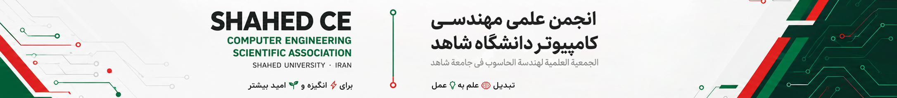
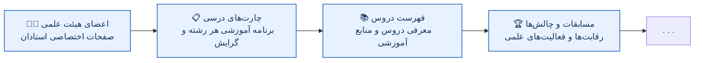

  <!-- نشان رسمی انجمن را در مسیر profile/assets/shahed-ce-logo.png قرار دهید -->
  

  ## 💻 انجمن علمی مهندسی کامپیوتر دانشگاه شاهد

  **تبدیل 🧠 علم به 💡 عمل؛ برای ⚡ انگیزه و 🌱 امید بیشتر.**

  **دوره شورای انجمن: ۱۴۰۵–۱۴۰۶ | ۲۰۲۶–۲۰۲۷**

  🇮🇷 **فارسی** · 🇬🇧 [English](README.md) · 🇸🇦 [العربية](README.ar.md)

  
  
  
  
  
  
  

  **📰 نشریه ماتریس**

  
  
  

---

## 👋 خوش آمدید

ما **انجمن علمی مهندسی کامپیوتر دانشگاه شاهد** هستیم؛ جامعه‌ای دانشجویی که یادگیری دانشگاهی را به تجربه عملی، پژوهش، همکاری و فرصت‌های تازه پیوند می‌دهد.

ما باور داریم که یک انجمن علمی باید چیزی فراتر از برگزارکننده رویدادها باشد. انجمن می‌تواند فضایی باشد که در آن دانشجویان با یکدیگر یاد می‌گیرند، پروژه می‌سازند، تجربه‌های خود را به اشتراک می‌گذارند، با اعضای هیئت علمی و متخصصان ارتباط برقرار می‌کنند و دستاوردهایی خلق می‌کنند که برای نسل‌های آینده نیز مفید و ماندگار باشد.

🌐 **جامعه‌ای آنلاین:** تمام فعالیت‌ها، رویدادها و همکاری‌های ما از طریق بسترهای آنلاین هماهنگ و اجرا می‌شوند تا دانشجویان، دانش‌آموختگان، اعضای هیئت علمی و همکاران بتوانند بدون محدودیت مکانی در آن‌ها مشارکت کنند.

## 🎯 مأموریت ما

- 🧠 پیوند دادن دانش نظری با مهارت‌ها و تجربه‌های عملی.
- 📚 ترویج یادگیری مستمر، پژوهش و به‌اشتراک‌گذاری دانش.
- 🛠️ حمایت از پروژه‌های دانشجویی، فعالیت‌های متن‌باز و کار گروهی.
- 🤝 ایجاد ارتباط میان دانشجویان، اعضای هیئت علمی، دانش‌آموختگان و جامعه فناوری.
- 🚀 کمک به دانشجویان برای شناخت مسیرهای تحصیلی، پژوهشی و شغلی.
- 🗂️ مستندسازی فعالیت‌ها و به‌اشتراک‌گذاری دستاوردهای مفید با نسل‌های آینده.

## 🧩 حوزه‌های فعالیت

| حوزه | فعالیت‌ها |
|:---|:---|
| 🎓 یادگیری و مهارت‌آموزی | دوره‌ها، کارگاه‌ها، گروه‌های مطالعاتی و فعالیت‌های یادگیری عملی |
| 🔬 پژوهش | معرفی حوزه‌های پژوهشی، پروژه‌های دانشجویی، مباحثات علمی و فرصت‌های پژوهشی |
| 💻 پروژه‌ها و متن‌باز | پروژه‌های مشارکتی، کد، ابزارها و مستندات فنی |
| 🌐 جامعه و صنعت | نشست با متخصصان، دانش‌آموختگان، سازمان‌ها و جوامع فناوری |
| 📰 ترویج علم | مصاحبه‌ها، مقالات، مطالب آموزشی تخصصی و نشریه دانشجویی *ماتریس* |

## 🎓 رشته‌ها و برنامه‌های آموزشی

در این بخش، رشته‌ها و گرایش‌های تحصیلی ارائه‌شده در گروه مهندسی کامپیوتر دانشگاه شاهد معرفی می‌شوند. چارت‌های درسی و برنامه‌های ترمی هر رشته و گرایش نیز به‌تدریج اضافه خواهند شد.

| مقطع | رشته / گرایش | چارت درسی |
|:---|:---|:---:|
| 🎓 کارشناسی | مهندسی کامپیوتر — نرم‌افزار (B.Sc.) | به‌زودی |
| 🎓 کارشناسی ارشد | مهندسی و علوم کامپیوتر — معماری سیستم‌های کامپیوتری (M.Sc.) | به‌زودی |
| 🎓 کارشناسی ارشد | مهندسی و علوم کامپیوتر — امنیت سایبری (M.Sc.) | به‌زودی |
| 🎓 دکتری | مهندسی کامپیوتر — مهندسی شبکه | به‌زودی |

> 📚 **برنامه‌های درسی:** چارت‌های درسی و برنامه‌های ترم‌به‌ترم هر رشته و گرایش به‌تدریج منتشر خواهند شد.

## 📰 ماتریس — نشریه دانشجویی

**ماتریس** نشریه دانشجویی انجمن علمی مهندسی کامپیوتر دانشگاه شاهد است. این نشریه بستری برای انتشار مقالات علمی و فنی، مصاحبه‌ها، دستاوردهای پژوهشی، روندهای فناوری و دیدگاه‌های دانشجویان فراهم می‌کند.

🌐 **دنبال‌کردن ماتریس:** [📣 تلگرام](https://t.me/MatrisMagazine) · [🟦 روبیکا](https://rubika.ir/MatrisMagazine) · [✍️ ویرگول](https://virgool.io/MatrisMagazine)

🌱 از مشارکت دانشجویان، ایده‌های خلاقانه، مقاله‌نویسی و همکاری در زمینه‌های نگارش، ویرایش، پژوهش و طراحی استقبال می‌کنیم.

## 👥 شورای اجرایی انجمن

مدیریت انجمن بر عهده شورایی منتخب است که اعضا و مسئولیت‌های آن از طریق انتخابات سالانه دانشجویی تعیین و تجدید می‌شوند.

**دوره فعلی: ۱۴۰۵–۱۴۰۶ (۲۰۲۶–۲۰۲۷)**

| عضو | مسئولیت | گیت‌هاب |
|:---|:---|:---:|
| **سید علی عترتی** | 🧭 دبیر و مسئول انجمن | [@SAEtrati](https://github.com/SAEtrati) |
| **سید محمد عترتی** | 🌱 مسئول نشریات و نوآوری | [@SMEtrati](https://github.com/SMEtrati) |
| **محمدمهدی عیوضی** | ⚡ نایب‌دبیر و مسئول امور اجرایی | [@MAHDI1824](https://github.com/MAHDI1824) |
| **محسن انصاری‌فر** | 🧠 مسئول امور علمی و فرهنگی | [@Mohsen-A-F](https://github.com/Mohsen-A-F) |
| **محمدعلی شریف‌زاده حصاری** | 🎓 مسئول امور پژوهشی و دانشجویی | — |
| **محمد فاتح** | 📣 مسئول رسانه و ارتباطات | [@protonmemmad](https://github.com/protonmemmad) |

> 🤝 از ایده‌ها، مشارکت و همکاری شما استقبال می‌کنیم!

## 🏛️ اعضای هیئت علمی و گروه آموزشی

برای مشاهده اطلاعات رسمی گروه آموزشی مهندسی کامپیوتر و اعضای هیئت علمی، به [صفحه گروه مهندسی کامپیوتر دانشگاه شاهد](https://scimet.shahed.ac.ir/eng-comp) مراجعه کنید.

> [!NOTE]
> این بخش در حال تکمیل است. صفحات اختصاصی اعضای هیئت علمی به‌تدریج اضافه خواهند شد.

## 🗺️ نقشه راه فعلی

ما به‌تدریج در حال توسعه این فضای گیت‌هاب هستیم تا دسترسی به اطلاعات آموزشی، منابع علمی و فعالیت‌های دانشجویی آسان‌تر شود.

> 🌱 این موارد اولویت‌های فعلی ما هستند. با رشد انجمن و شکل‌گیری نیازها و فرصت‌های جدید، برنامه‌ها و ابتکارهای بیشتری نیز به این مسیر اضافه خواهند شد.

## 🤝 به ما بپیوندید

از دانشجویان، دانش‌آموختگان، اعضای هیئت علمی و متخصصانی که به فعالیت‌های ما علاقه‌مند هستند دعوت می‌کنیم با ما در ارتباط باشند و مشارکت کنند.

1. 🔎 مخازن این سازمان را بررسی کنید.
2. 📖 فایل `README` و مجوز استفاده (`License`) مخزن موردنظر خود را مطالعه کنید.
3. 💡 ایده‌های خود را مطرح کنید، مشکلات را گزارش دهید یا در صورت فعال بودن بخش Issues، پیشنهادهای خود را ثبت کنید.
4. 🧑‍💻 در صورت باز بودن امکان مشارکت و وجود دستورالعمل، از طریق `Pull Request` در توسعه مخازن همکاری کنید.
5. 🌟 به یاد داشته باشید که مستندسازی، طراحی، آزمون، پژوهش و به‌اشتراک‌گذاری تجربه نیز به‌اندازه برنامه‌نویسی ارزشمند هستند.

هر مخزن ممکن است حوزه فعالیت، قوانین مشارکت و مجوز خاص خود را داشته باشد. پیش از استفاده مجدد از محتوا یا مشارکت در هر مخزن، جزئیات مربوط به آن را بررسی کنید.

---

### 💡 با هم بیاموزیم، با هم بسازیم و اثری مفید و ماندگار بر جای بگذاریم.

**Shahed CE** · انجمن علمی مهندسی کامپیوتر دانشگاه شاهد

